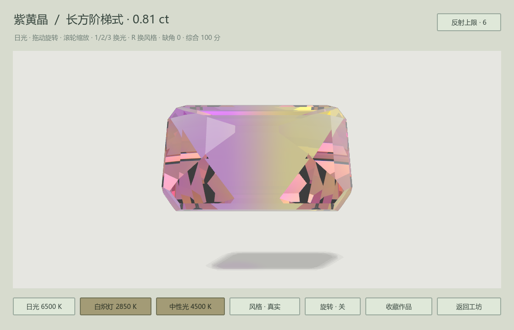
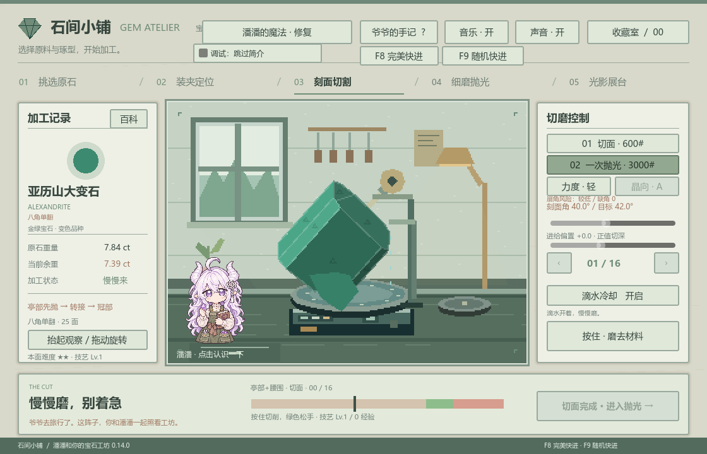
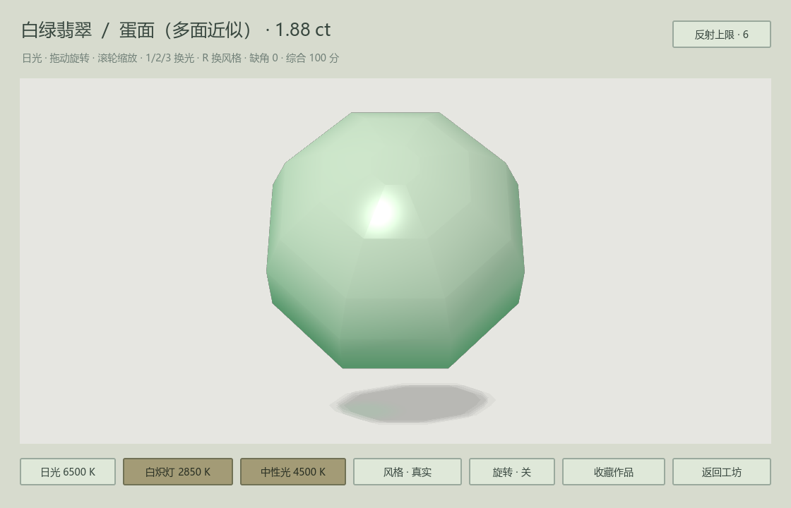
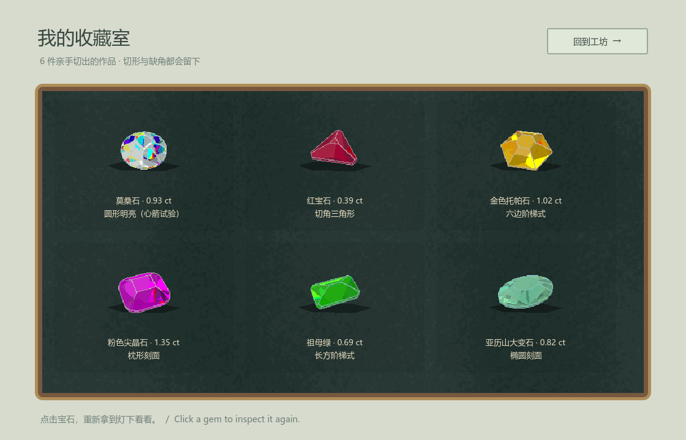

# 石间小铺 · Gem Atelier

挑一块原石，慢慢切出自己的宝石。做完换盏灯，转一转，再把它放进绒布收藏室。
Choose a rough stone, cut and polish it, turn it under different lights, then keep it in your velvet-lined collection.

**v0.14.0 Windows 体验版：13 种原料 × 14 种切工。**
**v0.14.0 Windows preview: 13 materials × 14 cuts.**

[下载游戏 / Download](https://github.com/TimrayZ/gem-atelier/releases/latest) · [宣传素材 / Media kit](https://github.com/TimrayZ/gem-atelier/releases/download/v0.11.0/GemAtelier-v0.11.0-MediaKit.zip)

## 开始游玩 / Play

1. 下载 **GemAtelier-v0.14.0-Windows-x64.zip**，完整解压，双击 **GemAtelier.exe**。无需安装 Godot，无需联网。
2. 左侧选择原料，右侧选择切工；按右下角按钮逐步加工，或按 **F8** 自动完成后续工序。
3. 成品拖动旋转、滚轮缩放，按 **1 / 2 / 3** 比较日光、白炽灯与中性光。
4. 喜欢就收入收藏室。点击收藏中的宝石，可随时重新旋转、换光查看。

Download the Windows ZIP, extract everything, and run **GemAtelier.exe**. Choose a material and cut, follow the work button or press **F8** for automatic processing. Drag to rotate, scroll to zoom, use **1/2/3** for lights, and save finished gems to reopen from the collection.

Windows 10/11 x64，显卡需支持 OpenGL 3.3。卡顿可把“反射上限”调到 3；像素与真实通道提供 3/6/12/20 档。尚未在多种电脑配置上验证。
Requires 64-bit Windows 10/11 and OpenGL 3.3. Both styles expose 3/6/12/20 reflection limits; try 3 for performance. Compatibility across other hardware remains unverified.

## 切削与成长 / Cutting and progression

蓝宝石使用较浅的游戏拟合吸收谱，反射上限新增 3 次选项，默认仍为 6 次。按住切削并在绿色区间松手；提前松手可以继续，过切会保留在实际形状中。手工完成刻面获得技艺经验；F8 完美快进剩余工序，F9 根据技艺等级随机快进；两者保留已经切出的形状和误差，不获得经验。潘潘可以修复最近一次崩角或裂损，使用后睡着，亲手完成另一颗每面 A 或以上的宝石才能醒来。绿色区间均为 S，并显示 90–100 完美度；过切按程度给 A、B 或 C。现在共有 14 种切工，原料估价为虚构游戏点数。

Sapphire uses a lighter illustrative absorption spectrum and a 3-bounce option is available alongside the default 6. Hold to cut and release in the green zone. Early releases can continue; overcuts affect the actual shape. Manual work earns skill XP. F8 completes remaining work perfectly; F9 fast-forwards with level-dependent mistakes. Both preserve existing cuts and grant no XP. After repairing the latest chip or fracture, Panpan sleeps until the player manually finishes another gem with every facet graded A or better. Green releases always earn S and a 90–100 perfection score. There are 14 cuts; rough prices are fictional game points.

## 工坊 / Workshop

- **13 种原料**：亚历山大变石、紫水晶、蓝宝石、钻石、透明正长石、合成莫桑石、祖母绿、粉色尖晶石、金色托帕石、红宝石、白绿翡翠、紫黄晶和双色碧玺。
- **14 种切工**：包括八面体、简易方形、长方阶梯、椭圆、蛋面多面近似及圆形明亮（心箭试验）。后者列为四星，尚未验证达到八心八箭。
- 原生晶形与磨圆料可选；切削逐面移除实际体积，切歪、崩角也会保留在作品中。每面一次抛光，支持滴水冷却与压力选择。
- 默认像素材质按前后刻面归并光影，采用柔光和较大色块；随转动显示反光与火彩。钻石随照明呈色，莫桑石使用更高色散，变石在日光和白炽灯下改变颜色。
- 大展台与独立绒布收藏室；按 **R** 切换像素／真实通道，两者均为纯色背景。
- 左侧百科收录组成、典型晶形、硬度、韧性、解理、折射率与拟合吸收谱。
- 支持导入 **GemCAD .asc / Gem Cut Studio .gcs** 常见平面刻面子集。压缩包“示例切工”包含两份等价的原创 CC0 练习设计。

Thirteen materials include white-green jadeite, ametrine and bicolour tourmaline. Fourteen cuts include an approximate cabochon and the four-star experimental round brilliant. Actual progressive solid cutting preserves mistakes and chips. Features include one polishing pass, cooling and pressure controls, a mineral encyclopedia, a large pixel/spectral viewer, saved-shape collections, and ASC/GCS import with original CC0 examples. The experimental brilliant is not verified as hearts and arrows.

| 操作 / Control | 功能 / Action |
| --- | --- |
| F8 / F9 | 完美／随机快进剩余工序，保留已有误差 / Perfect or random fast-forward, preserving existing mistakes |
| 空格或按住加工按钮 / Space or hold work | 加工当前面 / Work on current facet |
| ← / → | 切换加工面 / Select facet |
| 拖动 / Drag | 旋转观察 / Rotate |
| 滚轮 / Wheel | 缩放 / Zoom |
| 1 / 2 / 3 | 切换照明 / Change illuminant |
| H / J | 冠部／亭部正视 / Crown or pavilion view |
| R（大展台 / large viewer） | 像素／真实通道 / Pixel or spectral channel |
| Esc | 返回或关闭页面 / Back or close |

白绿翡翠以多面近似蛋面和柔和半透着色展示；紫黄晶与双色碧玺默认推荐长方阶梯，色带随晶体旋转。光源切换约 0.65 秒平滑过渡。[材料与光源实现说明](docs/分区宝石与光源渐变.md)。

White-green jadeite uses an approximate faceted cabochon and soft translucent shading. Ametrine and bicolour tourmaline default to a step cut; colour zones rotate with the stone. Light changes crossfade over about 0.65 seconds.

## 潘潘与小铺 / Panpan and the shop

中文全名 **格蕾丝·潘多拉·坦格利安**，英文 **Grace Pandora Targaryen**，昵称 **潘潘 / Panpan**。她是一只相当于人类不到十岁的小龙。爷爷开矿时遇见了她，她喜欢石头里的亮光，一路跟着装宝石的篮子回了工坊。她能背很多书，却还在理解书里的意思。主角负责操作工具，她帮忙翻书和整理收藏。爷爷去旅行了，主角暂时照看小铺。
Her name is **Grace Pandora Targaryen**, nicknamed **Panpan**. She is a young dragon comparable to a human child under ten. Grandfather met her while mining, and she followed his basket of sparkling stones back to the workshop. She can recite many passages but is still learning what they mean. The player operates the tools while she helps find books and organize the collection. Grandfather is away travelling.

潘潘默认安静，点击她才会用俏皮拟声打招呼；再点击查看详细介绍。介绍不阻塞加工，调试选项可跳过。[角色与故事设定](docs/角色与故事方案.md)。
Panpan stays quiet until clicked, then greets you with playful synthesized chatter. Click again for details. Introductions do not gate processing and can be skipped in debug mode. See the linked character and story notes.

## 切工导入与存档 / Import and saves

在挑原石阶段点击“导入切工”，选择 .asc 或 .gcs。支持角度、中心距、分度与 GCS 明确法线；尺寸会归一化，使用当前材料的折射率。暂不支持二进制 .gem、平底底尖、磨砂、非零 ASC 分度偏移或缺少深度的 GCS；会给出错误提示。详细边界与来源见[0.11 发布说明](docs/发布说明0.11.md)。
At the rough stage, choose Import and select ASC or GCS. Common angle/depth/index facets and explicit GCS normals are supported, normalized to game scale, using the selected material’s RI. Binary GEM, flat culets, frosting, nonzero ASC gear offsets and GCS without depth are currently unsupported and reported. See the release notes for details and format sources.

在展台点击“收藏真实切工”保存作品，包括导入配方与实际切后形状。存档和偏好仍位于 `%APPDATA%/Godot/app_userdata/石间 · Gem Atelier/`，兼容原有目录。加工中的石头不会自动保存；浏览收藏不会覆盖当前加工进度。
Collect finished pieces to save the imported recipe and actual geometry. Saves and preferences retain the original directory above. Work in progress is not autosaved; browsing collections preserves the current workshop session.

## 模拟范围 / Simulation limits

除翡翠使用专门的半透视觉近似外，两个通道均沿实际凸实体追踪光路，包含 Snell 折射、Fresnel 分配、全反射、色散与 Beer–Lambert 路径吸收。像素通道使用 12 波段与按前后刻面归并的采样，并量化明暗／颜色，真实通道使用 20 波段。呈色由光源光谱与拟合吸收共同决定；两种风格对基准吸收谱使用不同的美术倍率；更高色散的火彩仍依赖切工、观察角与光源。
Except for jadeite’s dedicated translucent approximation, both channels trace the actual convex solid using Snell refraction, Fresnel splitting, total internal reflection, dispersion and Beer–Lambert path absorption. Pixel mode uses 12 spectral bands, facet-grouped sampling, stylized lights and quantized values/colours; detailed mode uses 20 bands. Source spectra and fitted absorption determine colour; each style can apply a different artistic absorption multiplier; visible fire depends on cut, view and illumination.

吸收谱、晶向风险与温度阈值是游戏近似，未完整实现偏振、双折射、多色性、间接照明与焦散；翡翠的多晶散射和蛋面是视觉近似。细小混叠或转动闪烁仍可能出现。原石使用简化凸体；缺角通过凸截面移除体积，不模拟凹入贝壳状破口。参数不用于现实加工指导。
Spectra, cleavage risk and heat thresholds are gameplay approximations. Full polarization, birefringence, pleochroism, indirect illumination and caustics remain incomplete; jadeite scattering and its cabochon are visual approximations. Fine aliasing or shimmer may remain. Roughs use simplified convex geometry; chips remove volume with convex planes rather than concave fractures. Parameters are not manufacturing guidance.

## 源码与验证 / Source and validation

用 **Godot 4.7.2 Standard** 打开 `gem-atelier/project.godot`，导入后按 F5。Compatibility 渲染器，无需 .NET。Windows 导出需要同版本官方模板。
Open `gem-atelier/project.godot` in Godot 4.7.2 Standard, allow imports and press F5. Compatibility rendering requires no .NET. Export needs matching official templates.

全部 182 种材料／切工组合通过；另有光源过渡、色带与收藏恢复检查。导入等价几何、加工、保存恢复，以及收藏重看、缺角和进度恢复均有回归检查。测试入口：`test_workshop.gd`、`test_shapes.gd`、`test_cut_import.gd`、`test_first_release.gd`、`test_collection.gd`。运行例：`godot --headless --path gem-atelier --script res://tests/test_workshop.gd`；图形测试需要 OpenGL。
All 182 material/cut combinations pass, alongside light-transition, colour-zoning and collection checks. Regression scripts cover imported geometry, processing, persistence, collection reopening, chips and workshop restoration. Run the command above for model tests; graphical tests require OpenGL.

## 署名与许可 / Credits and licenses

- **Carefree — Kevin MacLeod (incompetech.com)**，音乐适用 [CC BY 4.0](https://creativecommons.org/licenses/by/4.0/)，录音未修改、降低播放音量。[原始来源 / Original source](https://remote.incompetech.com/music/royalty-free/index.html?Search=Search&isrc=USUAN1400037) · [完整音频署名 / Audio credits](gem-atelier/audio/CREDITS.md).
- [Godot Engine](https://godotengine.org/license/)，MIT 及相关第三方许可；Windows 下载附带运行时许可文本。MIT and third-party runtime notices accompany the Windows download.
- GPT 助手立绘按用户提供的角色参考由 AI 生成。GPT assistant portrait generated with AI from a user-provided character reference.
- 矿物数据 / Mineral facts: [Handbook of Mineralogy](https://www.handbookofmineralogy.org/)、[GIA](https://www.gia.edu/)。[本版研究与验证 / Research and validation](docs/发布说明0.11.md).

原始代码采用 [MIT](LICENSE)。音乐与涉及第三方角色参考的图像不在代码许可授权范围内。
Original code is [MIT licensed](LICENSE). Music and third-party rights associated with the character-reference artwork are excluded from that source-code license.
