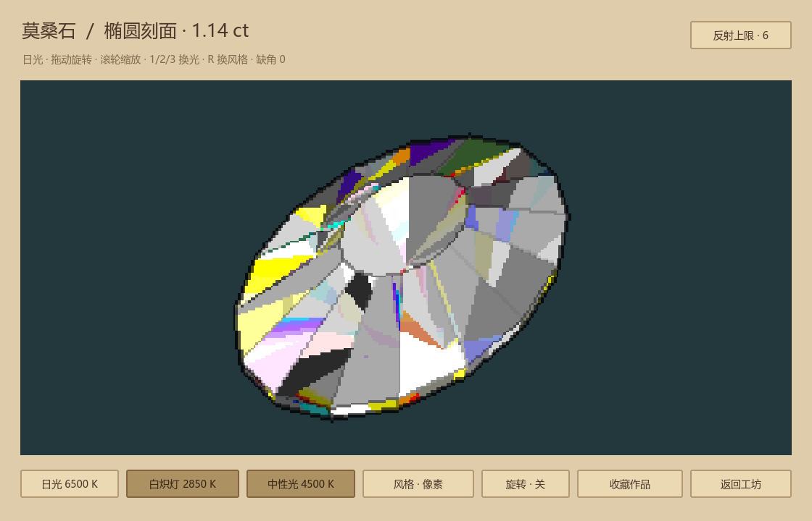
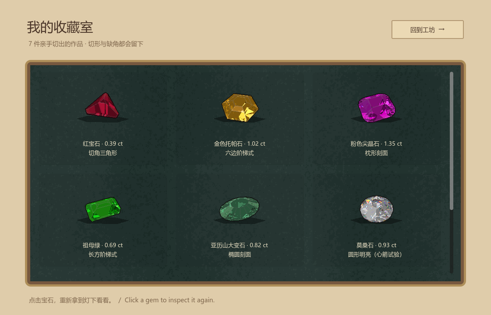

# 石间小铺 · Gem Atelier

挑一块原石，慢慢切出自己的宝石。做完换盏灯，转一转，再把它放进绒布收藏室。
Choose a rough stone, cut and polish it, turn it under different lights, then keep it in your velvet-lined collection.

**v0.12.1 Windows 体验版：10 种原料 × 10 种切工。**
**v0.12.1 Windows preview: 10 materials × 10 cuts.**

[下载游戏 / Download](https://github.com/TimrayZ/gem-atelier/releases/latest) · [宣传素材 / Media kit](https://github.com/TimrayZ/gem-atelier/releases/download/v0.11.0/GemAtelier-v0.11.0-MediaKit.zip)

## 开始游玩 / Play

1. 下载 **GemAtelier-v0.12.1-Windows-x64.zip**，完整解压，双击 **GemAtelier.exe**。无需安装 Godot，无需联网。
2. 左侧选择原料，右侧选择切工；按右下角按钮逐步加工，或按 **F8** 自动完成后续工序。
3. 成品拖动旋转、滚轮缩放，按 **1 / 2 / 3** 比较日光、白炽灯与中性光。
4. 喜欢就收入收藏室。点击收藏中的宝石，可随时重新旋转、换光查看。

Download the Windows ZIP, extract everything, and run **GemAtelier.exe**. Choose a material and cut, follow the work button or press **F8** for automatic processing. Drag to rotate, scroll to zoom, use **1/2/3** for lights, and save finished gems to reopen from the collection.

Windows 10/11 x64，显卡需支持 OpenGL 3.3。卡顿可把“反射上限”调到 6；像素与真实通道都提供 6/12/20 档。尚未在多种电脑配置上验证。
Requires 64-bit Windows 10/11 and OpenGL 3.3. Both render channels expose 6/12/20 reflection limits; try 6 for performance. Compatibility across other hardware remains unverified.

## 工坊 / Workshop

- **10 种原料**：亚历山大变石、紫水晶、蓝宝石、钻石、透明正长石、合成莫桑石、祖母绿、粉色尖晶石、金色托帕石、红宝石。
- **10 种切工**：八角单翻、椭圆、八重对称、长方阶梯、圆形明亮（心箭试验）、枕形、梨形、马眼、切角三角、六边阶梯。圆形明亮尚未验证达到八心八箭。
- 原生晶形与磨圆料可选；切削逐面移除实际体积，切歪、崩角也会保留在作品中。每面一次抛光，支持滴水冷却与压力选择。
- 默认像素材质按前后刻面归并光影，采用多方向灯光和较大色块；随转动显示反光与火彩。钻石随照明呈色，莫桑石使用更高色散，变石在日光和白炽灯下改变颜色。
- 大展台与独立绒布收藏室；按 **R** 切换像素／真实通道，两者均为纯色背景。
- 左侧百科收录组成、典型晶形、硬度、韧性、解理、折射率与拟合吸收谱。
- 支持导入 **GemCAD .asc / Gem Cut Studio .gcs** 常见平面刻面子集。压缩包“示例切工”包含两份等价的原创 CC0 练习设计。

Ten materials include alexandrite, amethyst, sapphire, diamond, orthoclase, synthetic moissanite, emerald, pink spinel, golden topaz and ruby. Ten cuts include octagonal, oval, eightfold, rectangular step, experimental round brilliant, cushion, pear, marquise, clipped triangle and hexagonal step. Actual progressive solid cutting preserves mistakes and chips. Features include one polishing pass, cooling and pressure controls, a mineral encyclopedia, a large pixel/spectral viewer, saved-shape collections, and ASC/GCS import with original CC0 examples. The experimental brilliant is not verified as hearts and arrows.

| 操作 / Control | 功能 / Action |
| --- | --- |
| F8 | 开始／停止快速加工 / Start or stop fast processing |
| 空格或按住加工按钮 / Space or hold work | 加工当前面 / Work on current facet |
| ← / → | 切换加工面 / Select facet |
| 拖动 / Drag | 旋转观察 / Rotate |
| 滚轮 / Wheel | 缩放 / Zoom |
| 1 / 2 / 3 | 切换照明 / Change illuminant |
| H / J | 冠部／亭部正视 / Crown or pavilion view |
| R（大展台 / large viewer） | 像素／真实通道 / Pixel or spectral channel |
| Esc | 返回或关闭页面 / Back or close |

## 潘潘与小铺 / Panpan and the shop

中文全名 **格蕾丝·潘多拉·坦格利安**，英文 **Grace Pandora Targaryen**，昵称 **潘潘 / Panpan**。她是爷爷当年救助的小龙，如今 26 岁，爱收集亮晶晶的东西，也想和你一起学加工。主角 24 岁，回乡替健康、外出旅行的爷爷照看一季小铺。
Her full name is **Grace Pandora Targaryen**, Chinese **格蕾丝·潘多拉·坦格利安**, nickname **Panpan**. The dragon your grandfather once rescued is now 26, loves collecting shiny things, and wants to learn gem cutting with you. The 24-year-old protagonist returns home to look after the shop while their healthy grandfather travels.

潘潘默认安静，点击她才会用俏皮拟声打招呼；再点击查看详细介绍。介绍不阻塞加工，调试选项可跳过。[角色与故事设定](docs/角色与故事方案.md)。
Panpan stays quiet until clicked, then greets you with playful synthesized chatter. Click again for details. Introductions do not gate processing and can be skipped in debug mode. See the linked character and story notes.

## 切工导入与存档 / Import and saves

在挑原石阶段点击“导入切工”，选择 .asc 或 .gcs。支持角度、中心距、分度与 GCS 明确法线；尺寸会归一化，使用当前材料的折射率。暂不支持二进制 .gem、平底底尖、磨砂、非零 ASC 分度偏移或缺少深度的 GCS；会给出错误提示。详细边界与来源见[0.11 发布说明](docs/发布说明0.11.md)。
At the rough stage, choose Import and select ASC or GCS. Common angle/depth/index facets and explicit GCS normals are supported, normalized to game scale, using the selected material’s RI. Binary GEM, flat culets, frosting, nonzero ASC gear offsets and GCS without depth are currently unsupported and reported. See the release notes for details and format sources.

在展台点击“收藏真实切工”保存作品，包括导入配方与实际切后形状。存档和偏好仍位于 `%APPDATA%/Godot/app_userdata/石间 · Gem Atelier/`，兼容原有目录。加工中的石头不会自动保存；浏览收藏不会覆盖当前加工进度。
Collect finished pieces to save the imported recipe and actual geometry. Saves and preferences retain the original directory above. Work in progress is not autosaved; browsing collections preserves the current workshop session.

## 模拟范围 / Simulation limits

两个通道均沿实际凸实体追踪光路，包含 Snell 折射、Fresnel 分配、全反射、色散与 Beer–Lambert 路径吸收。像素通道使用 12 波段与按前后刻面归并的采样，并量化明暗／颜色，真实通道使用 20 波段。呈色由光源光谱与拟合吸收共同决定；更高色散的火彩仍依赖切工、观察角与光源。
Both channels trace the actual convex solid using Snell refraction, Fresnel splitting, total internal reflection, dispersion and Beer–Lambert path absorption. Pixel mode uses 12 spectral bands, facet-grouped sampling, stylized lights and quantized values/colours; detailed mode uses 20 bands. Source spectra and fitted absorption determine colour; visible fire depends on cut, view and illumination.

吸收谱、晶向风险与温度阈值是游戏近似，未完整实现偏振、双折射、多色性、间接照明与焦散。细小混叠或转动闪烁仍可能出现。原石是简化单晶；缺角通过凸截面移除体积，不模拟凹入贝壳状破口。参数不用于现实加工指导。
Spectra, cleavage risk and heat thresholds are gameplay approximations. Full polarization, birefringence, pleochroism, indirect illumination and caustics remain incomplete. Fine aliasing or shimmer may remain. Roughs are simplified single crystals; chips remove volume with convex planes rather than concave fractures. Parameters are not manufacturing guidance.

## 源码与验证 / Source and validation

用 **Godot 4.7.2 Standard** 打开 `gem-atelier/project.godot`，导入后按 F5。Compatibility 渲染器，无需 .NET。Windows 导出需要同版本官方模板。
Open `gem-atelier/project.godot` in Godot 4.7.2 Standard, allow imports and press F5. Compatibility rendering requires no .NET. Export needs matching official templates.

全部 100 种材料／切工组合通过；5296 项模型检查零失败。导入等价几何、加工、保存恢复，以及收藏重看、缺角和进度恢复均有回归检查。测试入口：`test_workshop.gd`、`test_shapes.gd`、`test_cut_import.gd`、`test_first_release.gd`、`test_collection.gd`。运行例：`godot --headless --path gem-atelier --script res://tests/test_workshop.gd`；图形测试需要 OpenGL。
All 100 material/cut combinations and 5296 model checks pass. Regression scripts cover imported geometry, processing, persistence, collection reopening, chips and workshop restoration. Run the command above for model tests; graphical tests require OpenGL.

## 署名与许可 / Credits and licenses

- **Carefree — Kevin MacLeod (incompetech.com)**，音乐适用 [CC BY 4.0](https://creativecommons.org/licenses/by/4.0/)，录音未修改、降低播放音量。[原始来源 / Original source](https://remote.incompetech.com/music/royalty-free/index.html?Search=Search&isrc=USUAN1400037) · [完整音频署名 / Audio credits](gem-atelier/audio/CREDITS.md).
- [Godot Engine](https://godotengine.org/license/)，MIT 及相关第三方许可；Windows 下载附带运行时许可文本。MIT and third-party runtime notices accompany the Windows download.
- GPT 助手立绘按用户提供的角色参考由 AI 生成。GPT assistant portrait generated with AI from a user-provided character reference.
- 矿物数据 / Mineral facts: [Handbook of Mineralogy](https://www.handbookofmineralogy.org/)、[GIA](https://www.gia.edu/)。[本版研究与验证 / Research and validation](docs/发布说明0.11.md).

原始代码采用 [MIT](LICENSE)。音乐与涉及第三方角色参考的图像不在代码许可授权范围内。
Original code is [MIT licensed](LICENSE). Music and third-party rights associated with the character-reference artwork are excluded from that source-code license.
