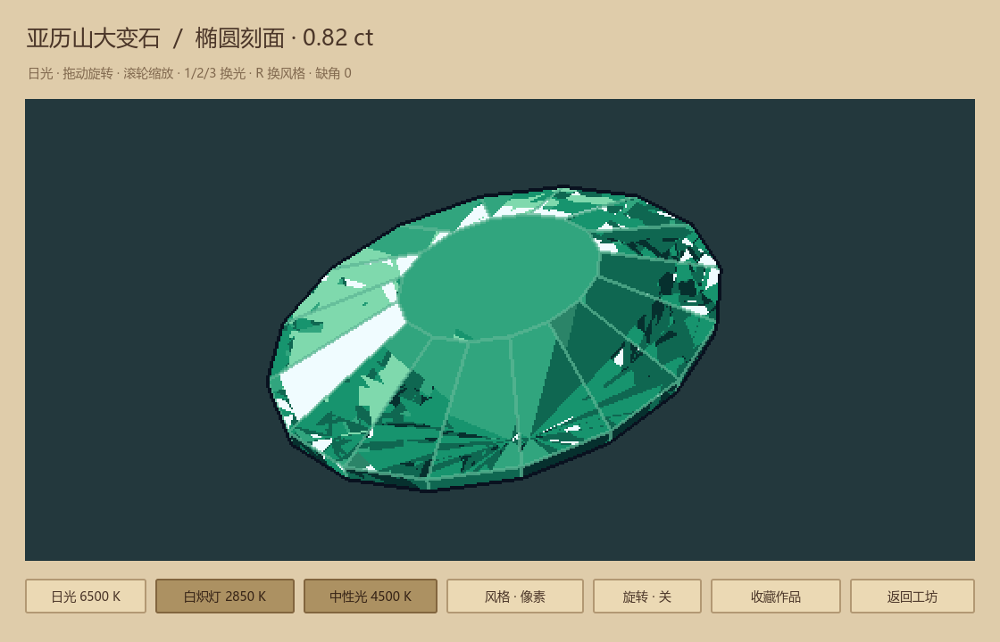
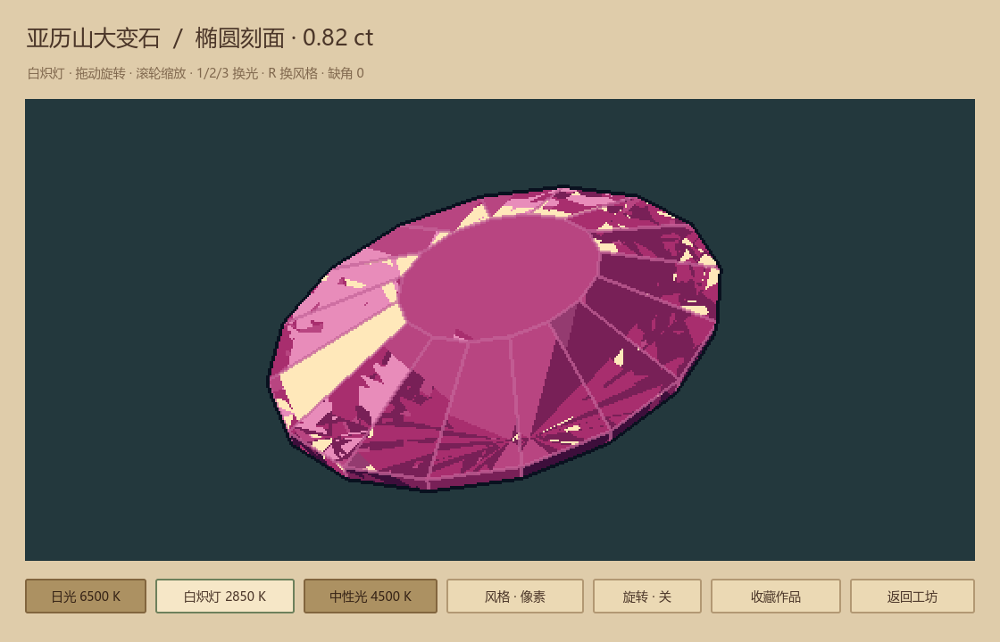
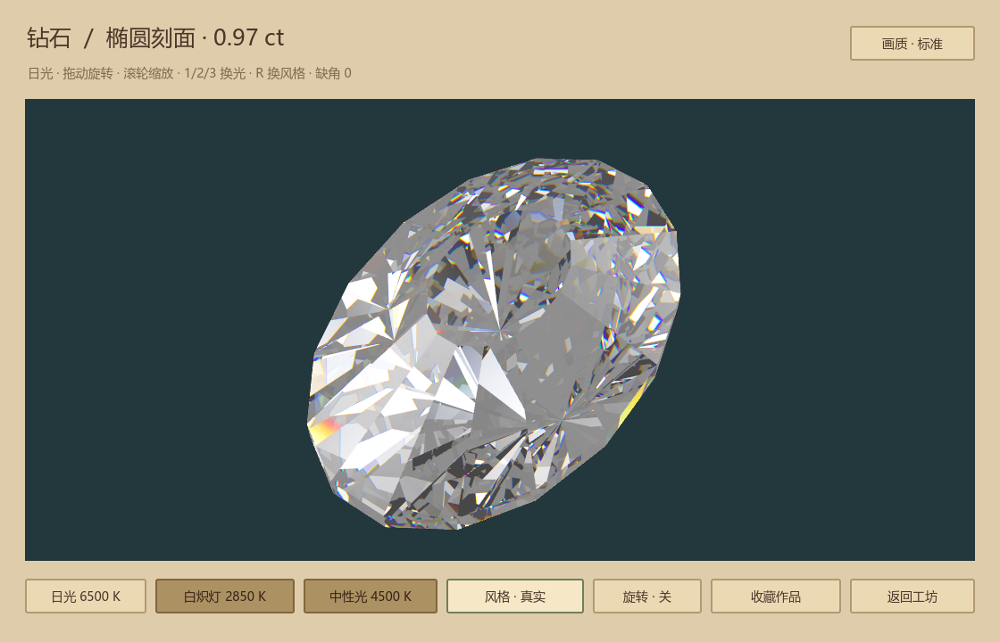

# 0.10-dev：像素材质与大展台已接入

本轮将材质接入主游戏与收藏室，默认像素风；新增放大的成品展台与可切换真实通道。只更新 GitHub 源码，不创建或替换 Release。Windows v0.9.0 下载包仍是之前的版本。
This update integrates materials into the game and collection room, defaults to pixel art, and adds a larger finished-piece exhibition with an optional spectral channel. It updates GitHub source only, with no release created or replaced. The Windows v0.9.0 download remains the earlier version.

## 当前游戏画面

完工与重新查看收藏会直接进入约 1064×518 的展示区。底部提供三种光源、像素／真实切换、自动旋转、收藏和返回。拖动旋转，滚轮缩放，1/2/3 换灯，R 切换通道；Esc 返回。真实通道有标准／流畅画质，流畅模式减少内部反射，部分亮度与细节也会变化。
Finishing or reopening a saved piece opens an exhibition region of approximately 1064×518. The bottom row contains three sources, pixel/spectral switching, rotation, collection and return. Drag to rotate, scroll to zoom, use 1/2/3 for lights, R for channels and Esc to return. The spectral channel offers standard/performance quality; fewer internal reflections can change brightness and detail.

默认像素材质直接在实际切后几何上组织刻面色块、背面明暗、轮廓和硬边高光。像素通道在 532×259 渲染，再以整数两倍显示；大展台投影按宽高比修正，宝石不会被横向拉宽。静止时缓存画面，旋转或换光时更新；关闭大展台后停掉其渲染，并避免同时追踪旧的小展台。
Pixel materials directly organize facet colours, back-facet values, outlines and hard highlights on the actual cut solid. The pixel channel renders at 532×259 and displays at exactly twice that size. Projection follows the exhibition’s aspect ratio without stretching gems horizontally. Still views are cached, updating for rotation or lighting; closing the exhibition stops rendering it, and the older small view is not traced simultaneously.

## 亚历山大变石的换光

同一实体、角度和吸收数据，6500 K 日光近似下以绿为主，2850 K 白炽灯近似下以红紫为主。像素模式对光源光谱与材料拟合吸收积分得到的颜色关系做有限调色映射，并压缩实际光程范围以减少杂色。更换光源不修改背景，也不直接把整张图染色。这属于风格化呈色，不是完整的多色性与偏振模拟。
The same solid, orientation and absorption data appear predominantly green under the 6500 K daylight approximation and red-purple under the 2850 K incandescent approximation. Pixel mode maps source-spectrum/material-absorption integration into a limited art palette and compresses actual path-length ranges to reduce mottling. Lighting changes do not recolour the background or tint the entire image. This is stylized colour response, not full pleochroism or polarization simulation.

## 通透感与转动火彩

正面与背面刻面的分组明暗来自入射面、实际折射出射面和有限次全反射；切歪或缺角会改变这些边界。对钻石，使用两条不同折射率光线的出射差别，在宽光源边界定位少量黄／青色火彩；表面高光和透射高光分开判断。改变观察角度会移动或消退这些区域，未叠加随机闪光贴纸。
Grouped front/back facet values follow the entry face, actual refracted exit face and limited total internal reflections; wrong cuts and chips change those boundaries. Diamond fire uses differing refractive-index exit paths to place limited yellow/cyan regions near a broad light-source boundary. Surface and transmitted highlights are tested separately. View changes move or remove these regions without random sparkle overlays.

为了保持画面简洁，像素模式使用主透射路径、有限光程和调色，不累加全部反射分支，也没有完整光能守恒积分。它追求像素美术中的通透感；光谱对照通道承担更细的光路呈现。
For visual simplicity, pixel mode follows a primary transmitted path, bounded path lengths and palette mapping rather than summing all reflected branches or fully integrating energy. It aims for readable pixel-art transparency, while the spectral comparison channel provides finer optical presentation.

## 真实通道：纯色背景

保留已有 20 波段的受限凸多面体光追：Snell 折射、Fresnel 分光、全反射、Cauchy 色散与 Beer–Lambert 吸收。移除了环境中的幕布、折痕、地板、环纹和舞台；背景只有统一纯色，两块解析光源提供照明。没有增加场景模型或背景纹理。
The detailed channel retains the existing constrained 20-band convex-solid tracer: Snell refraction, Fresnel splitting, total internal reflection, Cauchy dispersion and Beer–Lambert absorption. Curtains, folds, floor, rings and stage have been removed from the environment. A single solid background and two analytic light sources remain, with no scenery models or background textures added.

它仍是本项目的受限自定义渲染器，不是完整专业光学引擎：折射率为标量，吸收为拟合；没有完整双折射、偏振、间接场景照明或地面焦散。内部反射有上限，细小混叠与旋转闪烁仍可能存在。
It remains this project’s constrained custom renderer, not a complete professional optical engine: refractive index is scalar and absorption is fitted, without full birefringence, polarization, indirect scene illumination or floor caustics. Internal reflections are capped; fine aliasing and rotational shimmer may remain.

## 收藏室

收藏缩略图与主展台共用几何／材质配置代码，固定采用像素通道。修正缩略图宽高比，保持原切形比例；布料采用稳定的像素色阶，阴影改为简洁接触色块。每张缩略图只渲染一次。保存格式沿用原来的面平面、重量和缺角记录，重看后仍能回到未完成的加工。
Collection thumbnails share geometry/material configuration with the main exhibition and always use the pixel channel. Their aspect ratio is corrected, cloth uses stable pixel values and shadows use simple contact shapes. Each thumbnail renders once. Existing plane, weight and chip records are retained, and inspection still returns to work in progress.

## 验证

`test_pixel_game.gd` 使用真实 GUI 输入检查换灯、拖动、在图外松开、通道切换、返回与重新打开；检查默认像素、相同石头的日绿／暖红紫、转动后火彩位置变化、有限调色与真实通道纯色背景。测试样本的像素钻石有 19 种输出颜色；火彩标记像素从 906 变为 325，表明固定光源下转动改变了可见区域。统计只用于回归，不是宝石评价标准。
`test_pixel_game.gd` uses actual GUI input to check lighting, dragging, release outside the image, channel switching, return and reopening. It checks pixel defaults, daylight-green/incandescent-red-purple response on one gem, changing fire under rotation, limited palettes and the spectral channel’s solid background. The sample pixel diamond has 19 output colours; marked fire pixels change from 906 to 325 as rotation changes visible regions under a fixed source. These are regression metrics, not gemstone grades.

收藏重新加载与缺角保持、手动加工与碎块物理、快速加工与单次抛光、默认静音与主动帮助、原石形态、真实通道内含物、反射次数对照及背景不染色检查均通过。没有改动原有切削配方和存档几何。
Collection reload and chipped-shape retention, manual processing and debris physics, fast processing and one-pass polishing, quiet defaults and explicit help, rough forms, spectral-channel inclusions, bounce comparisons and material-independent backgrounds pass. Cutting recipes and saved geometry are unchanged.

相关代码：`scripts/gem_renderer.gd`、`shaders/gem_pixel.gdshader`、`shaders/gem_optics.gdshader`、`scripts/exhibition.gd`。历史探索位于 `docs/prototypes`，不参与主游戏运行。
Relevant code: `scripts/gem_renderer.gd`, `shaders/gem_pixel.gdshader`, `shaders/gem_optics.gdshader`, and `scripts/exhibition.gd`. Historical studies in `docs/prototypes` do not run in the main game.

视觉参照：[timbercyke《一颗钻石里藏着多少光？》](https://www.bilibili.com/video/BV18YxK6NEPy/)。实现参考：[Godot CanvasItem 着色器](https://docs.godotengine.org/en/stable/tutorials/shaders/shader_reference/canvas_item_shader.html)。材质代码为本项目自己的实现。
Visual reference: [timbercyke, 一颗钻石里藏着多少光？](https://www.bilibili.com/video/BV18YxK6NEPy/). Implementation reference: [Godot CanvasItem shaders](https://docs.godotengine.org/en/stable/tutorials/shaders/shader_reference/canvas_item_shader.html). Material code is this project’s implementation.
