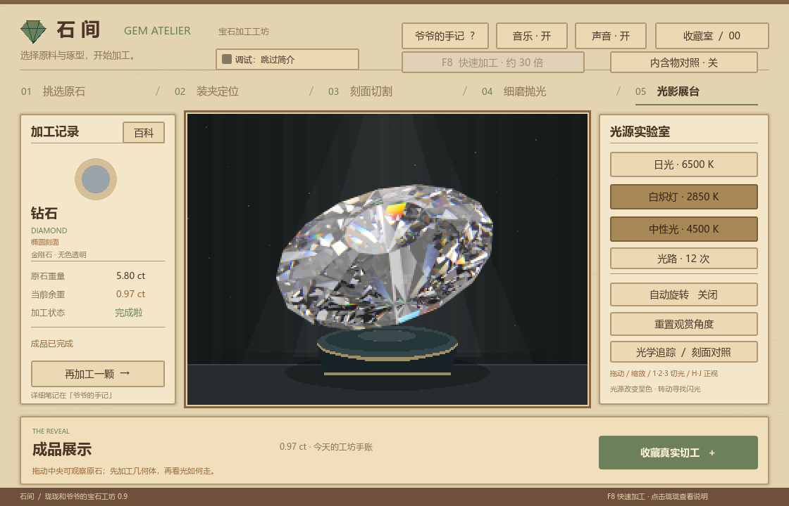
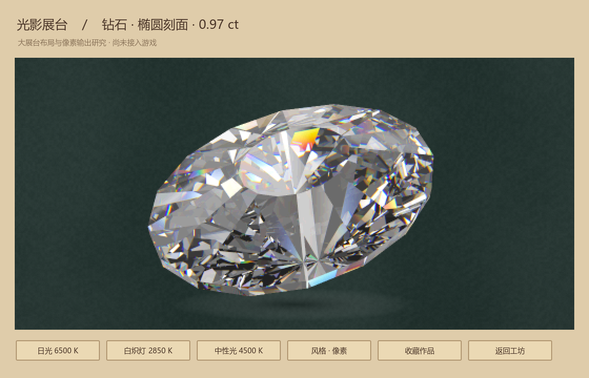

# 像素化与大展台：方案及真实渲染样张

建议：保留收藏室的收藏、读取与重新查看功能，统一它的视觉；成品增加更大的独立展台，并提供像素／细腻切换。本次提交的是可复现的渲染与布局原型，尚未改动主游戏的交互和默认风格，不更新 Release。
Recommendation: retain collection storage and reopening, unify its presentation, and add a larger standalone exhibition with pixel/smooth switching. This commit contains a reproducible rendering and layout prototype; it does not change main-game interactions or defaults, nor update a release.

## 参考方向与已确认范围

用户提供的视觉参考为 timbercyke《一颗钻石里藏着多少光？》，作品简介为“用 Godot 制作的 3D 像素宝石动画”。这里采用用户指出的像素宝石方向；没有据此推断作者的具体光路算法或声称复现其代码。
The user’s visual reference is timbercyke’s 一颗钻石里藏着多少光？, described as a 3D pixel-gem animation made in Godot. This study follows that visual direction without inferring the author’s exact transport algorithm or claiming to reproduce their code.

当前游戏已经使用 CanvasItem 着色器计算实际切后几何的光学路径。新的工作重点是输出风格、构图和可读性，沿用已有折射、反射、全反射、色散与吸收计算。
The game already uses a CanvasItem shader to calculate optical paths through the cut geometry. The new work concerns output style, composition and readability, while retaining refraction, reflection, total internal reflection, dispersion and absorption.

## 同一颗钻石的对照

以下两张使用同一实体、角度、日光和反射上限，只切换末端呈现。文字界面保持原样。
These images use the same solid, orientation, daylight and bounce limit, changing only final presentation. Text remains unchanged.

### 细腻输出 / Smooth output


### 2 像素块输出 / Two-pixel blocks



原型先以当前光学层的分辨率渲染，再把每个 2×2 像素块在线性光空间合并，处理透明度后输出；屏幕网格固定。样张使用每通道 32 级颜色量化，正式美术调色尚未确定。没有加入规则抖动纹理。更粗的 3×3 对照会进一步损失细碎光彩，因此当前推荐先验证 2 像素档。
The prototype renders the optical pass first, then integrates each 2×2 pixel block in linear light with alpha handling and a fixed screen grid. The study uses 32 levels per colour channel; a final art palette remains undecided. It adds no ordered-dither texture. A coarser 3×3 comparison loses more fine sparkle, so the two-pixel setting is the recommended starting point.

这仍然会减少细节，不能保证消除摩尔纹或旋转闪烁。正式接入前应比较静止、慢转和快速拖动，并检查变石换灯的呈色是否被过强的色阶压平。保留细腻模式，便于对照。
This reduces detail and does not guarantee removal of moiré or rotational shimmer. Integration should compare still, slow rotation and fast dragging, and check that colour quantization does not flatten alexandrite’s illuminant response. Keep smooth mode for comparison.

## 大展台布局



把 1120×720 窗口中的展示区从 568×414 扩大为约 1064×518，宝石在样张中约占 540 像素宽。这里按新的宽高比重新设置光学投影，增加实际渲染像素，保持宝石比例；不会仅把旧纹理横向拉宽。顶部保留名称、琢型、重量；灯光、风格、收藏与返回收在底部一行。图中的按钮仅作布局示意，尚未接线。
The study increases the exhibition region in a 1120×720 window from 568×414 to approximately 1064×518, with the gem around 540 pixels wide. It adjusts optical projection and actual render resolution for the new aspect ratio, preserving gem proportions rather than stretching the old texture. Name, cut and weight sit above; lights, style, collection and return sit below. The pictured buttons are layout placeholders, not connected controls.

正式交互建议支持拖动旋转、滚轮缩放、1/2/3 换灯；返回后保留观察角度。加工记录、光路诊断和高级参数放进可展开详情。大展台可从完工页和收藏作品页进入。
Proposed interaction includes drag rotation, wheel zoom and 1/2/3 lighting, retaining the view on return. Processing records, path diagnostics and advanced settings belong in expandable details. Enter the large exhibition from a finished piece or a reopened collection item.

## 收藏室改动边界

收藏室继续保留木框、哑光绒布、可滚动陈列与真实几何缩略图。视觉调整集中在：缩略图使用同一像素输出规则；绒布纤维改为较低频、稳定的像素纹理；阴影贴近石头、粗细与其他像素相配；标签用留白分组。宝石不必全部放到同一大小，但要限制最大尺寸，防止长形切工挤进邻格。
Retain the wooden frame, matte velvet, scrollable arrangement and actual-geometry thumbnails. Visual changes should share pixel presentation across thumbnails, use lower-frequency stable fabric texture, bring shadows close to the stones at a matching pixel scale, and group labels with whitespace. Gems need not share identical apparent size, but maximum bounds should keep elongated cuts within their slots.

保存格式、缺角几何、重量、重新查看和回到原加工进度的行为继续沿用。缩略图只需一次渲染并缓存，避免把整个收藏室变成持续运算的多个光学视口。
Reuse save format, chipped geometry, weights, reopening and restoration of work in progress. Render and cache thumbnails once rather than continuously tracing every collection item.

## 实施与验证建议

下一次先接入可选呈现层和大展台入口，统一缩略图，再调整布料与阴影。大展台实际渲染面积增加，性能需要重新测量；高分辨率模式与低性能模式可分别设置上限。验证应覆盖不同窗口比例、拖拽、光源、变石与钻石、不同切形、崩角收藏、返回原石和关闭弹窗。预计约一至两天做初版接入与图形回归，最终像素粗细还需用户观感反馈；这不是已经完成的功能清单。
Implement optional presentation and the large-view entry first, then consistent thumbnails, cloth and shadows. The larger rendered area needs new performance measurements and separate quality/performance limits. Verify window aspect ratios, dragging, lights, alexandrite and diamond, cut variations, chipped collections, return to work and modal closure. Allow roughly one to two working days for initial integration and graphical regression, with user feedback for final pixel scale. This is a proposed implementation scope, not a completed feature list.

## 复现原型 / Reproduce

使用仓库匹配的 Godot，在仓库根目录运行：
Using the matching Godot version, run from the repository root:

```powershell
godot --path gem-atelier --audio-driver Dummy --script docs/prototypes/preview_style.gd
```

如 Godot 将脚本路径解释为项目目录内路径，请把 `--script` 参数替换成该脚本的绝对路径。先创建仓库根目录的 `artifacts` 文件夹；样张写入其中。脚本不会写入玩家收藏。现有主游戏可照常从 `project.godot` 运行。
If Godot resolves the script relative to the project directory, pass its absolute path instead. Create the root `artifacts` folder first; captures go there. The script does not write player collections. The main game continues to run normally from `project.godot`.

实现依据：[Godot CanvasItem shader reference](https://docs.godotengine.org/en/stable/tutorials/shaders/shader_reference/canvas_item_shader.html) 中的纹理采样与像素尺寸；[PBRT Image Reconstruction](https://www.pbr-book.org/4ed/Sampling_and_Reconstruction/Image_Reconstruction) 中的采样与重建原则。原型用项目自己的 shader 和现有切后实体生成图片。
Implementation references: texture sampling and pixel dimensions in the [Godot CanvasItem shader reference](https://docs.godotengine.org/en/stable/tutorials/shaders/shader_reference/canvas_item_shader.html), and sampling/reconstruction principles in [PBRT Image Reconstruction](https://www.pbr-book.org/4ed/Sampling_and_Reconstruction/Image_Reconstruction). The images are rendered with this project’s shaders and cut solid.
