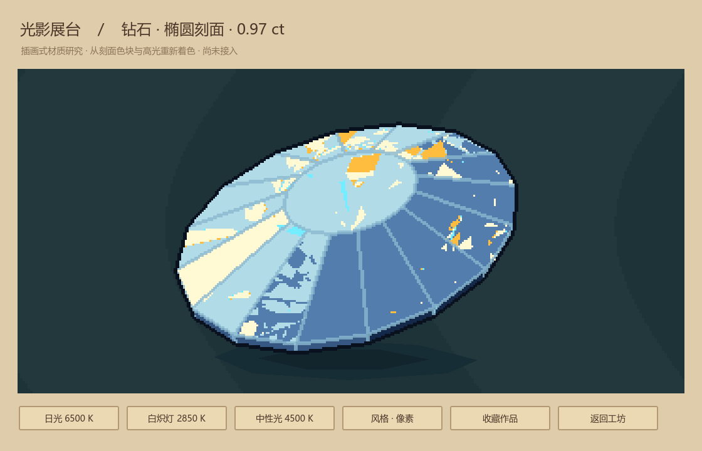
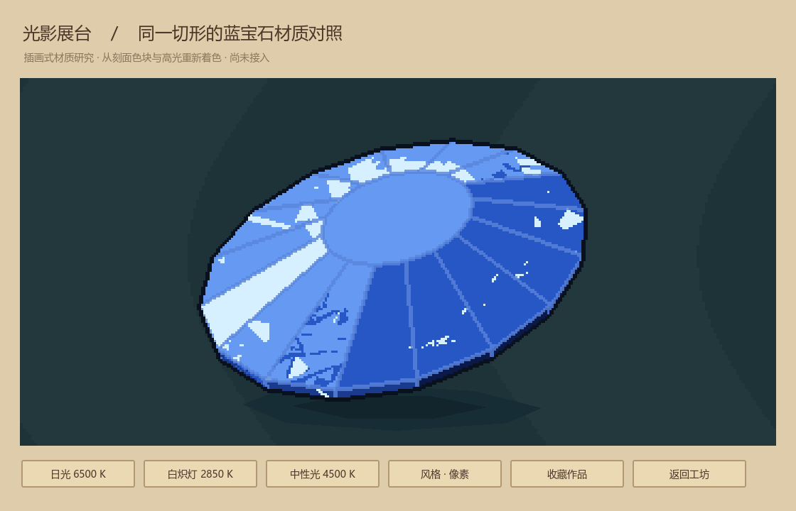

# 宝石材质风格修订：从刻面与光照开始

**上一轮“拟真光学输出后归并像素块”的方向未达到目标，已被用户指出并否定。** 本文改为以原视频实际画面为依据的材质研究。大展台的空间安排可以继续参考，原来的马赛克效果不作为目标风格。
**The previous approach—grouping pixels after realistic optical rendering—did not meet the target and was rejected by the user.** This revision studies the material against the actual reference frames. The larger exhibition layout remains useful; its previous mosaic appearance is not the target style.

本次仅更新文档和独立原型，主游戏、存档格式、收藏功能与 v0.9.0 Release 不变。图中按钮是布局示意，尚未接入交互。
This update changes documentation and standalone prototypes only. The main game, saves, collection behaviour and v0.9.0 release remain unchanged. The pictured controls are layout placeholders.

## 看过的参考与观察

原视频：[timbercyke《一颗钻石里藏着多少光？》](https://www.bilibili.com/video/BV18YxK6NEPy/)。通过网页播放器实际观察了开头约 1 秒、6 秒的红宝石，约 17 秒的祖母绿与约 27 秒的蓝宝石画面；没有把作品简介当成具体算法说明，也没有取得作者着色器源码。
Reference: [timbercyke, 一颗钻石里藏着多少光？](https://www.bilibili.com/video/BV18YxK6NEPy/). The browser player was used to inspect ruby at approximately 1 and 6 seconds, emerald at 17 seconds and sapphire at 27 seconds. The description was not treated as an algorithm specification, and the author’s shader source was not obtained.

画面上能直接看到的特征：刻面由少量清楚的大色块组织；相邻面的边线可读；高光是硬边浅色区域；祖母绿的内部有明暗变化但整体色调统一；地面投影也按色块表达。这里描述的是可见结果，不据此断言作者内部一定使用了哪种实现。
Visible characteristics include a few clear, large facet-colour regions, readable facet boundaries, hard-edged pale highlights, internally varied yet coherent emerald colours, and block-like ground shadows. These are observations of the result, not claims about the author’s internal implementation.

## 新原型：直接在材质里组织颜色





新原型保留真实切后边界。入射光命中哪个面、折射之后从哪一面离开，由实体平面与折射率计算；全反射仍会改变主透射路径。最终显示改为美术设计的有限调色板、分段刻面明暗、深色外轮廓和浅色刻面线。画布采用固定像素网格，但已经不从拟真成图取样后压成马赛克。
The new prototype retains actual cut boundaries. Solid planes and refractive index determine the entry facet and refracted exit, with total internal reflection affecting the primary transmitted path. Final appearance uses an art-directed limited palette, stepped facet values, a dark silhouette and pale facet lines. A fixed pixel grid remains, but the result is no longer sampled from a realistic finished image and turned into a mosaic.

光源简化为一个宽的工作室光源区域，高光采用明确的色块阈值。钻石的少量黄／青火彩取决于两条不同折射率光线穿过当前实体后的出射差别，集中在光源边界；没有额外撒随机亮点。布料和投影也改为更简洁的色块，避免只有宝石一个部分改变风格。
Lighting is simplified to one broad studio-source region, with explicit highlight thresholds. Limited yellow/cyan diamond fire depends on differing exit paths through the current solid at two refractive indices, concentrated near the light boundary rather than random sparkles. Cloth and shadows also use simpler colour regions to keep the presentation coherent.

这些选择是本项目的实现尝试，尚不能视为作者方案的复刻。蓝宝石图用于展示同一切形下的另一组材质调色，不是另一次蓝宝石加工流程。刻面碎亮斑仍可继续减少，调色和线宽也需要按实际游戏尺寸再打磨。
These are this project’s implementation choices, not a reproduction of the reference author’s method. The sapphire image demonstrates another material palette on the same cut, not a separate sapphire-processing workflow. Small highlight fragments, palette choices and line weights still need refinement at gameplay size.

## 光学取舍应明确

这是风格化材质原型，使用主透射路径与有限的全反射步数，并非完整的多分支光能积分。蓝宝石等材料目前使用固定美术调色；现有吸收参数的读取不等于每种材料的最终颜色都已经通过完整光谱传输生成。亚历山大变石的换灯效果、火彩方向与动态稳定性还需专门验证，不在本次两张静图中宣称完成。
This stylized prototype follows a primary transmitted path with a limited number of total-internal-reflection steps, rather than integrating every branch’s energy. Materials such as sapphire currently use fixed art palettes; reading absorption data does not mean every final colour comes from full spectral transport. Alexandrite’s lighting response, fire direction and motion stability need dedicated validation and are not claimed complete from these two stills.

正式接入建议保留细腻光学作为对照模式；像素风成为独立的材质表达，共享真实切形、缺角与材料参数。继续以“切错的形状会影响光路”为约束，再对显示结果做美术归纳。
For integration, retain the detailed optical renderer as a comparison mode. Pixel art should be an independent material expression sharing actual cut shapes, chips and material parameters. Wrong geometry should continue to affect light paths, with art direction applied to their presentation.

## 收藏室与大展台

收藏室不需要重写保存、读取和重新查看。需要更新的是宝石材质、缩略图的统一像素尺度、布料色阶、投影形状及标签留白；旧的连续噪声绒布和过软阴影应随新方向调整。缩略图继续从已保存的真实边界生成，并缓存一次渲染结果。
Collection saving, loading and reopening do not require rewriting. Update gem materials, thumbnail pixel scale, cloth values, shadow shapes and label spacing; continuous-noise cloth and overly soft shadows should follow the new style. Continue generating cached thumbnails from actual saved boundaries.

大展台建议约 1064×518 展示区域，单颗宝石约 500–550 像素宽。顶部只留名称、切形和重量，底部收纳灯光、风格、收藏与返回。放大时增加实际渲染分辨率并修正投影比例，保持宝石几何比例。加工参数和诊断放到可展开详情。
Use an exhibition region around 1064×518, with the gem about 500–550 pixels wide. Keep name, cut and weight above, and lights, style, collection and return below. Increase actual render resolution and adjust projection when enlarging, preserving geometric proportions. Put processing parameters and diagnostics in expandable details.

## 可复现原型与下一步

先创建仓库根目录 `artifacts` 文件夹，再从根目录运行：
Create the root `artifacts` folder, then run from the repository root:

```powershell
godot --path gem-atelier --audio-driver Dummy --script docs/prototypes/preview_illustrated.gd
```

必要时将 `--script` 换成脚本的绝对路径。输出两张材质样张，不写入玩家收藏。`preview_style.gd` 与旧样张仅作为被否定方向的对照保留。
Use an absolute script path if needed. It outputs two material studies without writing player collections. `preview_style.gd` and its older images remain only as a record of the rejected approach.

下一次实施优先做旋转对照、变石双光源、坏角显示和收藏缩略图，再接入大展台按钮；应先确认材质方向，再花时间铺满整个界面。粗估约一至两天进行材质迭代与图形回归，最终观感仍依赖用户反馈；本次没有接入主游戏或发布新版。
Next, compare rotation, alexandrite under two sources, chipped geometry and collection thumbnails before wiring the large-view controls. Confirm the material direction before extending it across the interface. Roughly one to two working days would cover material iteration and graphical regression, with final appearance dependent on user feedback. No main-game integration or new release is included here.

实现参考：[Godot CanvasItem 着色器](https://docs.godotengine.org/en/stable/tutorials/shaders/shader_reference/canvas_item_shader.html)。本项目原型代码与图片均在仓库内，视频链接用作视觉参照。
Implementation reference: [Godot CanvasItem shaders](https://docs.godotengine.org/en/stable/tutorials/shaders/shader_reference/canvas_item_shader.html). This project’s prototype code and rendered images are included in the repository; the linked video is a visual reference.
